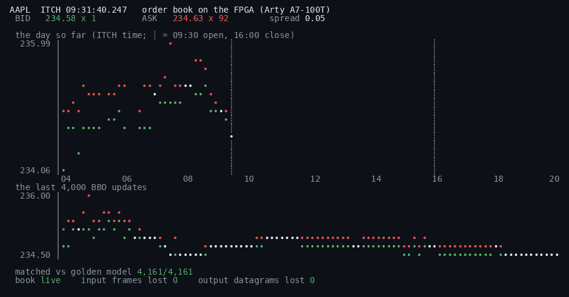
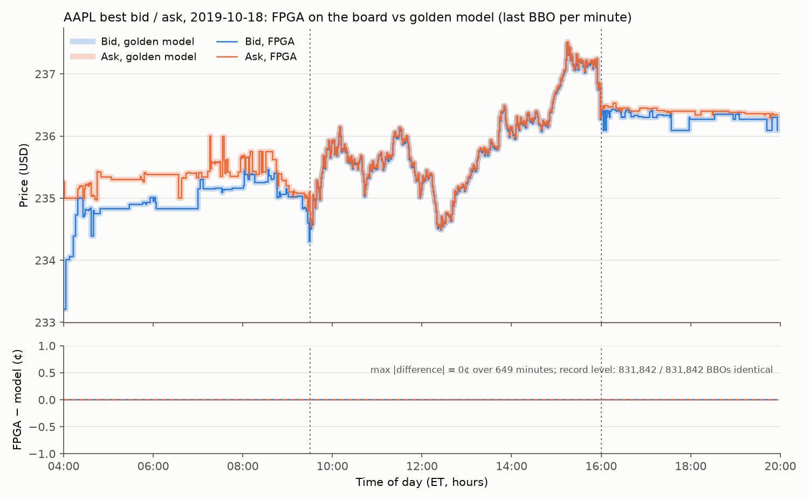
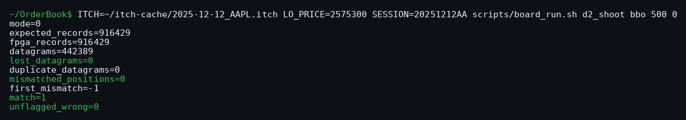
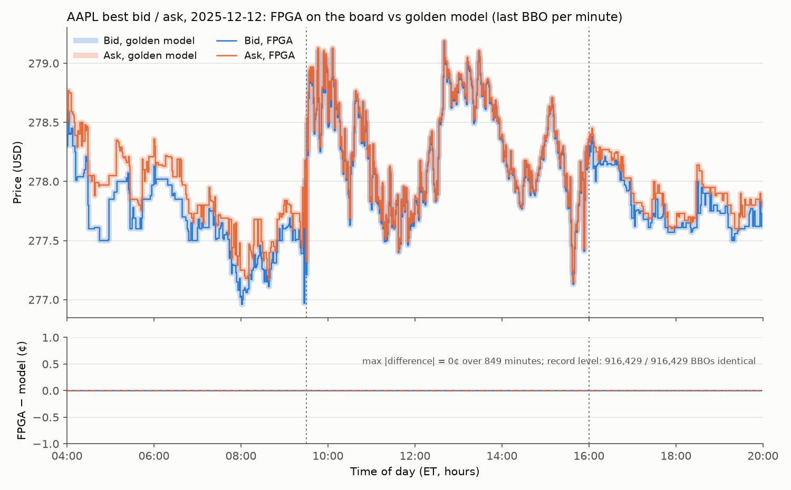
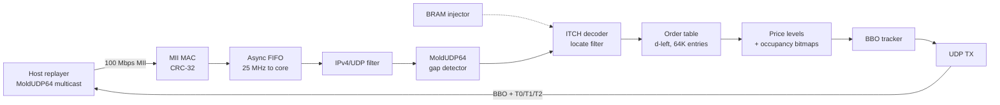
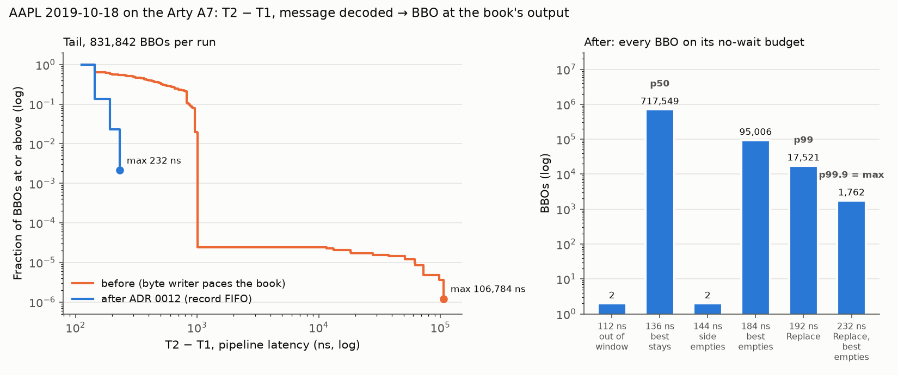

# Ethernet-to-Order-Book on an FPGA: a NASDAQ ITCH 5.0 book in SystemVerilog

A market-data pipeline for the Digilent Arty A7-100T. Raw Ethernet frames come in, a full
NASDAQ ITCH 5.0 order book is rebuilt in block RAM, and best bid/offer (BBO) updates go
back to the host with hardware timestamps. The book is scored message by message against
a Python golden model over a full trading day.

**Status: the full pipeline runs on the board.** A whole NASDAQ trading day of AAPL
(2019-10-18, 1,669,592 messages) replayed into the Arty produced **831,842 BBO updates,
all byte-identical to the golden model**, with no frame lost, in four runs
([CSV](data/results/2026-11-09_full_day_board.csv)). Phase A is tagged (`v0.1-model`);
Phases B–D are working on hardware and finishing their checklists. Phase E (latency) is
under way: on the same day, every BBO left the book **17 to 29 cycles (136–232 ns) after
its cause message's last byte** ([sidecar](data/results/2026-11-11_record_fifo_board.md)).

Every number here comes from a CSV in [`data/results/`](data/results/), produced by a `make`
target or a command in its sidecar `.md`, with its measurement conditions stated.
`[TBD]` means not measured yet.

*The order book on the board, rendered from a recorded run (`make demo-gif`): AAPL's
2019-10-18 trading day sweeps past as the FPGA publishes it (top: the day so far on an ITCH
time axis; below: the last 4,000 BBO updates), and every BBO is checked against the golden
model as it arrives. Live, the same view is `analysis/bbo_view.py`.*

*The FPGA's best bid and ask (thin lines) over the golden model's (wide lines), last BBO
per minute, and their difference: 0¢ in every minute. At record level all 831,842 updates
are identical ([CSV](data/results/2026-11-09_board_vs_model_bbo_1min.csv)). Generated by
`make plots`.*

**The busier day, 2025-12-12** (twice day 1's peak of live AAPL orders, [ADR 0010](docs/decisions/0010-order-table-16-way.md)):

*Run `d2_shoot` ([sidecar](data/results/2026-11-10_full_day_board_16way.md)): the GIF and the
`compare` output are rendered from its log by `make demo-gif-day2` (the second image draws
the saved terminal output; it is not a screen grab). The plot (`make plots`) is the last BBO
per minute from run `d2_16way`: 850 minutes, 0¢ difference in every one
([CSV](data/results/2026-11-10_board_vs_model_bbo_1min_day2.csv)).*

## At a glance

| | |
|---|---|
| **Board / PHY** | Arty A7-100T (`xc7a100tcsg324-1`), TI DP83848J 10/100 MII |
| **Pipeline** | MII MAC → CDC → IPv4/UDP filter → MoldUDP64 → ITCH decoder → order table → price levels → BBO |
| **Pipeline latency T2−T1** | p50 / p99 / p99.9 / max: **136 / 192 / 232 / 232 ns** (17 / 24 / 29 / 29 cycles at 125 MHz), 831,842 BBOs on the board, AAPL 2019-10-18 ([CSV](data/results/2026-11-11_record_fifo_board.csv)) |
| **Pipeline capacity** | `[TBD]` msg/s (on-chip injector, `DATA_W` 8 and 64) |
| **Line-rate throughput** | `[TBD]` msg/s at 100 Mbps |
| **Hardware full-day replay** | **0 mismatches on two days**: AAPL 2025-12-12, 916,429 / 916,429 BBO updates; AAPL 2019-10-18, 831,842 / 831,842; 0 frames lost, `table_overflow`/`unknown_ref` 0, never stale ([CSV](data/results/2026-11-10_full_day_board_16way.csv)) |
| **Golden model, full day** | AAPL 2019-10-18: 1,669,591 messages, 0 unknown refs, 0 negative shares; peak 27,814 live orders ([CSV](data/results/2019-10-18_AAPL_summary.csv)) |
| **Order table** | 2-bank d-left, 2 × 2,048 × 16 = 65,536 entries, 100 BRAM36; **0 overflows** on both days, including a 54,981-live-order peak that overflowed a 4-way table of the same size 14,717 times ([CSV](data/results/2025-12-12_AAPL_bounded.csv)) |
| **Events verified in sim** | 1,009,900 random ITCH records plus both full days through the RTL book, 0 mismatches ([CSV](data/results/2026-11-10_sim_full_book.csv)) |
| **Functional coverage** | `[TBD]` |
| **Formal proofs** | Async FIFO (in fpga-eth-core) and the price-level bitmap search (`tb/formal/bitmap_search.sby`), SymbiYosys |
| **Bugs caught** | Listed [below](#bugs-found) and, with symptom → cause → fix, in the [lab notebook](docs/log.md) |
| **Timing** | Full chip meets 125 MHz: WNS +0.028 ns, WHS +0.020 ns, Vivado 2025.2 ([report](docs/reports/arty_top/summary.txt)) |
| **Utilization** | 12,351 LUT (19 %), 19,073 FF (15 %), 119 / 135 BRAM36 (88 %), 10 DSP ([report](docs/reports/arty_top/utilization.rpt)) |
| **CI** | `make ci` locally: Verilator lint, cocotb regression, formal, model tests, host build + tests (ASan/UBSan), clang-tidy, ruff; the same `make ci` runs on GitHub Actions on every push ([workflow](.github/workflows/ci.yml)) |

## Status

| Phase | State | Key result |
|---|---|---|
| A — Python golden model + data | **Complete** (`v0.1-model`) | Full-day replay; table and window sized from data |
| B — MAC + IPv4/UDP on hardware | Working on the board | [fpga-eth-core](https://github.com/RodeanAzari/fpga-eth-core) `eth-core-v0.1`/`v0.2` released and in use here; photo/ILA captures outstanding |
| C — MoldUDP64 + ITCH decoder | Working on the board | Trace mode: 198,084 / 198,084 decoded records match the model ([CSV](data/results/2026-11-09_first_board_run.csv)) |
| D — Order book engine | Working on the board | Two full days, 0 mismatches; table reshaped to 16 ways for the busier day ([ADR 0010](docs/decisions/0010-order-table-16-way.md)) |
| E — Timestamping + latency measurement | In progress | T0/T1/T2 in every BBO; T2−T1 on the board fully determined by message type ([sidecar](data/results/2026-11-11_record_fifo_board.md)); cut-through built and sim-verified, board comparison pending |
| F — Stress, coverage closure, portfolio | Not started | |

Design and decisions: [docs/design.md](docs/design.md). Lab notebook: [docs/log.md](docs/log.md).

## Architecture

- **Clocking:** an MMCM makes the core clock (start 125 MHz) and the PHY's 25 MHz reference.
  The PHY's receive clock is the only other domain.
- **CDC:** one async FIFO (Gray pointers) and one toggle synchronizer for the T0 timestamp.
- **Interfaces:** AXI4-Stream between blocks, with backpressure everywhere except the MII
  input, which has an overflow counter.
- **Reuse:** the MAC and IPv4/UDP layer lives in its own payload-agnostic repo,
  [fpga-eth-core](https://github.com/RodeanAzari/fpga-eth-core), and will be consumed
  here as a git submodule (`rtl/eth/`) at a release tag. Two other FPGA projects use it
  too, so it knows nothing about ITCH. Its RX and TX paths are verified in simulation and
  meet timing at 125 MHz; its first release waits on the hardware gate test.

## Verification, by layer

| Layer | State |
|---|---|
| Golden model | 24 pytest tests; full-day self-consistency on real data; per-message flag contract checked on 1,669,591 messages |
| cocotb vs. golden model | Every block and the whole chip (`ob_core`, frames in → datagrams out) scored against the model; injected bugs caught in each test (counts in the [lab notebook](docs/log.md)) |
| Formal (SymbiYosys) | Async FIFO; price-level bitmap search |
| Hardware scoreboard | `analysis/compare.py` over a captured day: record by record, plus `unflagged_wrong` (a BBO wrong without its stale flag): 0 on every run, including 4 runs that lost input ([CSV](data/results/2026-11-09_board_loss_diagnosis.csv)) |

RTL testbenches use [tb-common](https://github.com/RodeanAzari/tb-common), a shared
cocotb library (AXI-Stream driver and monitor, an in-order scoreboard that dumps context
on the first mismatch, seeded random with logged seeds). It's pinned at tag
`tb-common-v0.1`. The Ethernet layer's own verification (formal FIFO proof, 21 cocotb
tests, planted bugs) is described in the
[fpga-eth-core README](https://github.com/RodeanAzari/fpga-eth-core#verification-by-layer).

The golden model comes in two forms:

- **Unbounded book:** defines the correct BBO.
- **Bounded book:** applies the RTL's exact limits (table geometry, price window and entry
  widths). It is what the hardware will be scored against.

The model tests each pin a failure mode that would silently corrupt the book, for example:

- using the execution price from `C` instead of the resting price;
- `U` forgetting the original order's side;
- dropping out-of-window orders so their cancels become unknown refs;
- one unknown message type desynchronizing everything after it.

A seeded adversarial generator produces table overflows, out-of-window prices, unknown refs,
crossed and locked books, and non-subset message types. A test fails if the generator ever
stops reaching any of them.

### Bugs found

1. **The specified order table could not work on real data.** Replaying the day's real
   order refs showed that the low ref bits cluster: one bucket held 18 live orders at
   16,384 sets. Even a good hash leaves Poisson peaks of 8, so a single-hash 4-way table
   overflows at any size that fits. Caught by the golden model before any RTL was written.
   The fix is [ADR 0001](docs/decisions/0001-order-table.md).
2. **The generator never produced a locked book.** Crossing orders were never removed, so
   the book stayed permanently crossed. Caught by the generator's coverage test.
3. **The generator never triggered the out-of-window flag.** Far prices always sat on the
   harmless side of the window. Caught by the same test.

## The order table

**What it does:** `E`, `C`, `X`, `D` and `U` messages carry only an order reference, with no
price or side. The book needs a ref → order table in BRAM, and capacity is the hard limit.

**Measured (AAPL, 2019-10-18):** 27,814 peak live orders, max ref 287,271,257 (29 bits),
largest order 82,045 shares.

| Design (banks × sets × ways) | Entries | Worst bucket over the day | Overflow inserts | BRAM36 |
|---|---|---|---|---|
| 1 × 16,384 × 4, low-bits hash | 65,536 | 18 | not run | 96 |
| 1 × 16,384 × 4, multiplicative hash | 65,536 | 8 | 36,545 | 96 |
| 2 × 4,096 × 4, d-left | 32,768 | n/a | 55,626 | 48 |
| 2 × 8,192 × 4, d-left (first choice, ADR 0001) | 65,536 | ≤ 4 | 0 | 96 |
| **2 × 2,048 × 16, d-left (chosen, ADR 0010)** | **65,536** | **≤ 16** | **0, and 0 on day 2** | **100** |

Sources: [`_table_fill.csv`](data/results/2019-10-18_AAPL_table_fill.csv),
[`_table_dleft.csv`](data/results/2019-10-18_AAPL_table_dleft.csv).

**A second, busier day changed the shape.** AAPL on 2025-12-12 peaks at 54,981 live orders,
84 % of the table. The 4-way table overflowed 14,717 times there, and the book was flagged
stale from pre-market on. The same 65,536 entries arranged as 16 ways (2 × 2,048 × 16) have
0 overflows on both days: a wider bucket tolerates a fuller table. It costs 4 BRAM36 and
about 4,800 LUTs, and timing still closes ([ADR 0010](docs/decisions/0010-order-table-16-way.md),
[`2025-12-12_AAPL.md`](data/results/2025-12-12_AAPL.md)).

**Chosen:** two banks, each indexed by a multiplicative hash with its own odd multiplier,
both read in the same cycle. An insert goes to the emptier bucket. Because an odd multiplier
is a bijection, the remaining product bits are a complete tag (21 bits at 2,048 sets), so an
entry is 56 bits. Width limits (`ref_overflow`, `shares_overflow`) are counted, never
truncated.

**Verified:** in this exact configuration, the bounded golden model had zero table, ref,
shares and unknown-ref errors on both days
([day 1](data/results/2019-10-18_AAPL_bounded_2x2048x16.csv),
[day 2](data/results/2025-12-12_AAPL_bounded_2x2048x16.csv)), and so did the RTL, in
simulation ([`sim_full`](data/results/2026-11-10_sim_full_book.csv)) and on the board
([board](data/results/2026-11-10_full_day_board_16way.csv)).

## Price levels and the price window

Per side, a BRAM array of aggregate shares covers 4,096 one-cent ticks around a base fixed
for the day, with a two-level occupancy bitmap to find the next best level when the top
empties. Both options are documented in §6.4 of the spec: a sorted top-K register array was
rejected because it loses depth.

- **Base:** the golden model's opening mid, $234.55 ([ADR 0002](docs/decisions/0002-price-window-base.md)).
- **Coverage:** the window held 831,837 of 831,839 two-sided BBOs.
- **The two misses:** both were in a nearly empty book at the session edges (04:00:11, bid
  $175.12; 20:00:00, ask $260.00).
- **Out-of-window orders:** 16,099 orders (1.85 %) priced outside the window, mostly stub
  quotes. They stay in the order table so their cancels resolve.

**How the hardware knows its BBO is wrong:** it never stores an out-of-window order's price,
only which edge the order fell past. Four live counters (per side, better or worse than the
window) set an `out_of_window` flag on the BBO. The flag fires exactly when the published
BBO differs from the true one: 0 violations over every message of the day, and 4 flagged
updates in total.

## Timestamping and cut-through

Every BBO record carries three stamps from one 125 MHz counter ([ADR 0011](docs/decisions/0011-timestamps.md),
[docs/latency.md](docs/latency.md)): **T0**, the cause frame's SFD (±40 ns); **T1**, the
cause message's last byte at the decoder; **T2**, the BBO valid at the book's output.
T2−T1 is the pipeline latency. T2−T0 also contains the frame's serialization at 80 ns/byte
and the store-and-forward wait for its FCS, so it is the line-rate bound, not the pipeline.

| Metric (board, AAPL 2019-10-18, 831,842 BBOs, 500 pps) | min | p50 | p99 | p99.9 | max |
|---|---|---|---|---|---|
| T2−T1, ns | 112 | 136 | 192 | 232 | 232 |
| T2−T0, µs | 74.2 | 126.7 | 133.1 | 133.7 | 133.8 |

**No BBO waited.** Each one took exactly the no-wait cycle count of its cause: 17 cycles
for an Add, Delete or Reduce that keeps the best level, 23 when it empties the best, 24 for
a Replace, 29 for a Replace whose old order was alone at the best
([per cause](data/results/2026-11-11_record_fifo_board_causes.csv)). The first run had a
tail to 13,348 cycles: the output writer paced the book. A 545-record FIFO in front of the
writer removed it ([ADR 0012](docs/decisions/0012-record-fifo.md)).

**Cut-through** ([ADR 0013](docs/decisions/0013-cut-through.md)) is a build option. The
decoder sees each byte as it arrives instead of after the frame's FCS. The cost: a frame
that later fails its FCS has already moved the book, so it is counted (`cut_through_bad`)
and marks the book stale. In simulation, a 1,514-byte frame's first byte reaches the
decoder 520 ns after its SFD, against 121.5 µs store-and-forward. The board comparison of
T2−T0 in both builds is `[TBD]`.

## On the board, demos, in Vivado

The host (WSL2) sends the day as MoldUDP64 multicast with `host/replay` (C++, busy-wait
pacing) and configures the board and logs its output with `host/capture`;
`scripts/board_run.sh` runs both and then `analysis/compare.py`.

- **Full day, zero mismatches** at 500 and 200 packets/s ([CSV](data/results/2026-11-09_full_day_board.csv)).
- **What the board does under host bursts** ([diagnosis](data/results/2026-11-09_board_loss_diagnosis.md)):
  on a loaded host the replayer stalls and then sends late packets back to back. In a burst
  the board's output (64-byte BBO records) needs more wire time than its input, so
  backpressure fills the 2 KB MII FIFO and frames are dropped. Every drop is counted and
  every later BBO is flagged stale: never a silently wrong book. On a quiet host there are
  no drops.
- **Live demo:** `analysis/bbo_view.py` (the GIF above).
- **Vivado:** batch Tcl only (`syn/`), reports per build in [`docs/reports/`](docs/reports/).

## Results

| Result | Value | Conditions | Source |
|---|---|---|---|
| Messages in the day | 302,347,067 | `S101819-v50.txt.gz`, all symbols | [by_type](data/results/2019-10-18_AAPL_by_type.csv) |
| AAPL messages | 1,669,591 | locate 14 | [summary](data/results/2019-10-18_AAPL_summary.csv) |
| Peak concurrent live orders | 27,814 | AAPL, unbounded model | [summary](data/results/2019-10-18_AAPL_summary.csv) |
| Two-sided BBOs inside window | 831,837 / 831,839 | base 23,455 ticks, ±2,048 | [summary](data/results/2019-10-18_AAPL_summary.csv) |
| Table overflow, chosen table | 0 / 0 | 2 × 2,048 × 16 d-left, day 1 / day 2 | [day 1](data/results/2019-10-18_AAPL_bounded_2x2048x16.csv), [day 2](data/results/2025-12-12_AAPL_bounded_2x2048x16.csv) |
| `bbo_oow` (flagged updates) | 4 | same | [bounded](data/results/2019-10-18_AAPL_bounded.csv) |
| Golden-model full-day run time | 4 min 08 s | Python 3.14, WSL2 | [sidecar](data/results/2019-10-18_AAPL.md) |
| **Hardware full day: BBO updates identical to the model** | **831,842 / 831,842** | AAPL 2019-10-18, 500 and 200 pps, 4 runs | [full day](data/results/2026-11-09_full_day_board.csv) |
| Hardware: frames lost / feed gaps / stale | 0 / 0 / never | quiet host | [full day](data/results/2026-11-09_full_day_board.csv) |
| Hardware: `bbo_oow` / `price_oow` | 4 / 16,099 (= model) | ADR 0002 window | [full day](data/results/2026-11-09_full_day_board.md) |
| RTL sim, random records vs model | 1,009,900, 0 mismatches | seeded generator | [sim](data/results/2026-11-07_sim_random_1m.csv) |
| **Hardware day 2: BBO updates identical to the model** | **916,429 / 916,429** | AAPL 2025-12-12 (3.5 M AAPL messages), 500 pps, 2 runs | [16-way runs](data/results/2026-11-10_full_day_board_16way.md) |
| Hardware runs at host load 15 to 22 | 2 of 4 clean; failures were host receive loss and an MII FIFO overflow, both detected (0 unflagged wrong BBOs) | 16-way bitstream | [16-way runs](data/results/2026-11-10_full_day_board_16way.md) |
| Full-chip timing | 125 MHz met, WNS +0.028 ns | Vivado 2025.2 | [report](docs/reports/arty_top/summary.txt) |
| **Pipeline latency T2−T1 (board)** | **p50 136 ns, p99 192 ns, max 232 ns** | AAPL 2019-10-18, 831,842 BBOs, 500 pps | [sidecar](data/results/2026-11-11_record_fifo_board.md) |
| T2−T0, line-rate bound (board) | p50 126.7 µs, max 133.8 µs | same; store-and-forward | [sidecar](data/results/2026-11-11_record_fifo_board.md) |
| Pipeline capacity (injector), cut-through vs store-and-forward on the board | `[TBD]` (Phase E) | | |

## Limitations

- **100 Mbps.** The Arty has no transceivers and cannot do 10GbE. The datapath is
  parameterized by width, and an on-chip injector will measure the pipeline's real capacity.
  The PHY, not the pipeline, will be the throughput limit.
- **One symbol; sizing from two days.** The order table is sized from AAPL on 2019-10-18
  and 2025-12-12; the busier day fills it to 84 % at its peak. Overflow is counted, not
  silent, if a busier day outgrows it.
- **Fixed-rate replay, not real-time.** The hardware days were sent at a fixed 500 or 200
  packets/s; real-time pacing (with the market's own bursts) is not claimed.
- **The host must be quiet.** A loaded WSL2 host stalls the replayer for up to 100+ ms,
  which overflows the board's 2 KB input FIFO (counted and flagged, see above).
- **No retransmission.** A MoldUDP64 gap marks the book stale; it is never repaired.
- **Fixed price window.** No recentering during the day; out-of-window BBOs are flagged.
- **No published checksum for the day file.** Integrity rests on `gzip -t` and our own
  SHA-256 ([MANIFEST](data/MANIFEST.md)).

## Build and reproduce

Linux or WSL2 with Python ≥ 3.11 and GNU make. The day file (3.95 GB, not committed) goes in
`/mnt/d/itch/` or `ITCH_DAY=...`; see [data/MANIFEST.md](data/MANIFEST.md).

| Target | Does |
|---|---|
| `make setup` | Create `.venv` from pinned `requirements.txt` |
| `make model-test` | ruff, `mypy --strict` and pytest on the golden model |
| `make day-stats` | Full-day replay of AAPL through the golden model (about 4 minutes) |
| `make plots` | Regenerate every plot in `docs/media/` from `data/results/` |
| `make lint sim formal` | Verilator lint, cocotb regression, SymbiYosys proofs |
| `make host host-test` | C++ host tools (Release + Debug/ASan/UBSan) and their tests |
| `make ci` | Everything CI runs, locally |
| `make prog` | Program the Arty over JTAG (bitstream from `syn/build_top.tcl`) |
| `scripts/board_run.sh` | One hardware run: configure, replay, capture, compare |
| `make demo-gif` | Render the demo GIF from a recorded run |
| `make demo-gif-day2` | Render the day-2 GIF and `compare` image from run `d2_shoot` |
| `make clean` | Remove caches and build output |

The sizing and bounded-model runs are listed with their exact commands in
[the results sidecar](data/results/2019-10-18_AAPL.md). Board runs need the host set up as in
[docs/log.md](docs/log.md) (2026-11-09). Everything runs locally; hosted CI is `[TBD]`.

## Repository layout

| Path | Contents |
|---|---|
| `model/` | Golden model: ITCH parser, unbounded and bounded books, seeded generator, tests |
| `analysis/` | Day stats, symbol extract, table sizing, bounded-model check, plots |
| `data/results/` | The CSVs behind every number, each with a sidecar `.md` |
| `docs/` | Design, ADRs, lab notebook, media |
| `rtl/` | SystemVerilog: `eth/` (fpga-eth-core submodule), `feed/`, `book/`, `out/`, `top/`, `lib/` |
| `tb/` | cocotb tests and SymbiYosys proofs |
| `host/` | C++ replayer and capture tool |
| `syn/`, `constr/`, `scripts/` | Vivado Tcl, XDC, board-run scripts |

## Related repositories

This project owns two shared repos, built here and consumed only at release tags:

| Repo | What it is | Used here as |
|---|---|---|
| [fpga-eth-core](https://github.com/RodeanAzari/fpga-eth-core) | Payload-agnostic 10/100 Ethernet MAC + IPv4/UDP RX/TX for 7-series FPGAs, with two non-ITCH example designs and C++ host test tools | Git submodule at `rtl/eth/`, tag `eth-core-v0.2` |
| [tb-common](https://github.com/RodeanAzari/tb-common) | Shared cocotb helpers: AXI-Stream driver/monitor, in-order scoreboard, seeded RNG | `pip` dependency pinned at `tb-common-v0.1` in `requirements.txt` |

## Roadmap

- **Phase B:** MII MAC, CRC-32, async FIFO (formally proven) and IPv4/UDP on the board, with
  10 million packets counted against the host.
- **Phase C:** MoldUDP64 deframer, gap detection, ITCH decoder.
- **Phase D:** the order book in RTL, ending with a full-day hardware replay at zero
  mismatches.
- **Phase E:** latency distributions, a scope cross-check, and cut-through vs.
  store-and-forward.
- **Phase F:** coverage closure, timing closure, and a demo video.

## License

MIT, see [LICENSE](LICENSE). The `rtl/eth/` submodule (`fpga-eth-core`) is a separate
repository with its own terms.
