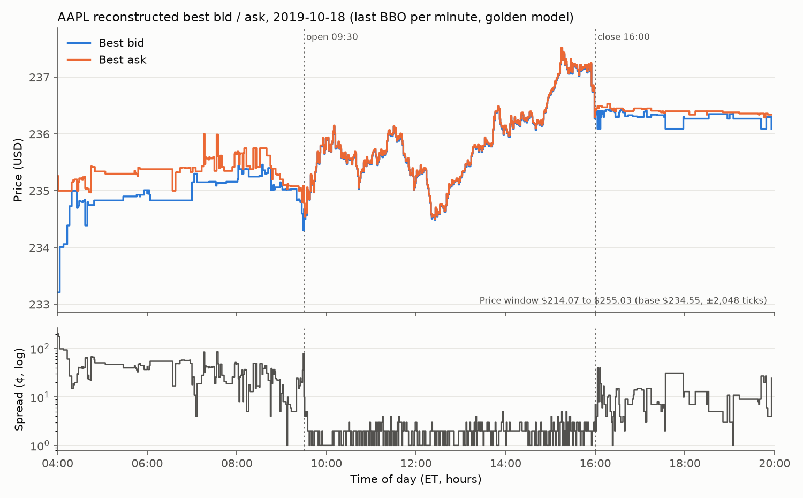
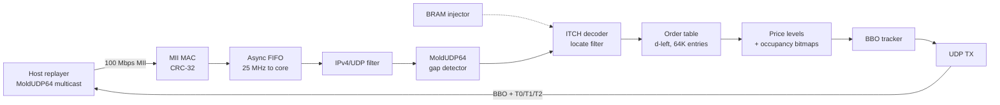

# Ethernet-to-Order-Book on an FPGA: a NASDAQ ITCH 5.0 book in SystemVerilog

A market-data pipeline for the Digilent Arty A7-100T. Raw Ethernet frames come in, a full
NASDAQ ITCH 5.0 order book is rebuilt in block RAM, and best bid/offer (BBO) updates go
back to the host with hardware timestamps. The book is scored message by message against
a Python golden model over a full trading day.

**Status: Phase A of six is complete (tag `v0.1-model`); Phase B is in progress.** The golden model has replayed a full NASDAQ day
(2019-10-18, 302,347,067 messages). Its numbers sized the hardware, and they overturned
the original order-table design (see [The order table](#the-order-table)). No RTL is on
hardware yet, so every hardware row below is `[TBD]`.

Every number here comes from a CSV in [`data/results/`](data/results/), produced by a `make`
target or a command in its sidecar `.md`, with its measurement conditions stated.
`[TBD]` means not measured yet.

*AAPL's best bid and ask across 2019-10-18, 04:00–20:00 ET, rebuilt by the golden model
from the raw ITCH feed (last BBO in each minute). The spread is 1–2¢ during regular hours
and up to dollars outside them. The FPGA's BBO will be overlaid on this in Phase D.
Generated by `make plots`.*

## At a glance

| | |
|---|---|
| **Board / PHY** | Arty A7-100T (`xc7a100tcsg324-1`), TI DP83848J 10/100 MII |
| **Pipeline** | MII MAC → CDC → IPv4/UDP filter → MoldUDP64 → ITCH decoder → order table → price levels → BBO |
| **Pipeline latency T2−T1** | p50 / p99 / p99.9 / max: `[TBD]` |
| **Pipeline capacity** | `[TBD]` msg/s (on-chip injector, `DATA_W` 8 and 64) |
| **Line-rate throughput** | `[TBD]` msg/s at 100 Mbps |
| **Hardware full-day replay** | `[TBD]` mismatches |
| **Golden model, full day** | AAPL 2019-10-18: 1,669,591 messages, 0 unknown refs, 0 negative shares; peak 27,814 live orders ([CSV](data/results/2019-10-18_AAPL_summary.csv)) |
| **Order table** | 2-bank d-left, 65,536 entries, 96 BRAM36; **0 overflows** over the day where a single-hash table of the same size had 36,545 ([CSV](data/results/2019-10-18_AAPL_table_dleft.csv)) |
| **Events verified in sim** | `[TBD]` (RTL) |
| **Functional coverage** | `[TBD]` |
| **Formal proofs** | `[TBD]` |
| **Bugs caught** | 3 so far, all before RTL ([below](#bugs-found)) |
| **Fmax** | `[TBD]` |
| **Utilization** | `[TBD]` LUT / FF / BRAM (planned BRAM budget in [design.md](docs/design.md#bram-budget-xc7a100t-135--bram36)) |
| **CI** | `[TBD]` (`make model-test` runs locally: 24 tests, ruff, `mypy --strict`) |

## Status

| Phase | State | Key result |
|---|---|---|
| A — Python golden model + data | **Complete** (`v0.1-model`) | Full-day replay; table and window sized from data |
| B — MAC + IPv4/UDP on hardware | In progress | [fpga-eth-core](https://github.com/RodeanAzari/fpga-eth-core) RX + TX verified in sim, timing met at 125 MHz; hardware link pending |
| C — MoldUDP64 + ITCH decoder | Not started | |
| D — Order book engine | Not started | |
| E — Timestamping + latency measurement | Not started | |
| F — Stress, coverage closure, portfolio | Not started | |

Design and decisions: [docs/design.md](docs/design.md). Lab notebook: [docs/log.md](docs/log.md).
Current state and next steps: [progress.md](progress.md).

## Architecture

- **Clocking:** an MMCM makes the core clock (start 125 MHz) and the PHY's 25 MHz reference.
  The PHY's receive clock is the only other domain.
- **CDC:** one async FIFO (Gray pointers) and one toggle synchronizer for the T0 timestamp.
- **Interfaces:** AXI4-Stream between blocks, with backpressure everywhere except the MII
  input, which has an overflow counter.
- **Reuse:** the MAC and IPv4/UDP layer lives in its own payload-agnostic repo,
  [fpga-eth-core](https://github.com/RodeanAzari/fpga-eth-core), and will be consumed
  here as a git submodule (`rtl/eth/`) at a release tag. Two other FPGA projects use it
  too, so it knows nothing about ITCH. Its RX and TX paths are verified in simulation and
  meet timing at 125 MHz; its first release waits on the hardware gate test.

## Verification, by layer

| Layer | State |
|---|---|
| Golden model | 24 pytest tests; full-day self-consistency on real data; per-message flag contract checked on 1,669,591 messages |
| cocotb vs. golden model | `[TBD]` (Phase B onward) |
| Formal (SymbiYosys) | `[TBD]` |
| Hardware scoreboard | `[TBD]` (Phase D) |

RTL testbenches use [tb-common](https://github.com/RodeanAzari/tb-common), a shared
cocotb library (AXI-Stream driver and monitor, an in-order scoreboard that dumps context
on the first mismatch, seeded random with logged seeds). It's pinned at tag
`tb-common-v0.1`. The Ethernet layer's own verification (formal FIFO proof, 21 cocotb
tests, planted bugs) is described in the
[fpga-eth-core README](https://github.com/RodeanAzari/fpga-eth-core#verification-by-layer).

The golden model comes in two forms:

- **Unbounded book:** defines the correct BBO.
- **Bounded book:** applies the RTL's exact limits (table geometry, price window and entry
  widths). It is what the hardware will be scored against.

The model tests each pin a failure mode that would silently corrupt the book, for example:

- using the execution price from `C` instead of the resting price;
- `U` forgetting the original order's side;
- dropping out-of-window orders so their cancels become unknown refs;
- one unknown message type desynchronizing everything after it.

A seeded adversarial generator produces table overflows, out-of-window prices, unknown refs,
crossed and locked books, and non-subset message types. A test fails if the generator ever
stops reaching any of them.

### Bugs found

1. **The specified order table could not work on real data.** Replaying the day's real
   order refs showed that the low ref bits cluster: one bucket held 18 live orders at
   16,384 sets. Even a good hash leaves Poisson peaks of 8, so a single-hash 4-way table
   overflows at any size that fits. Caught by the golden model before any RTL was written.
   The fix is [ADR 0001](docs/decisions/0001-order-table.md).
2. **The generator never produced a locked book.** Crossing orders were never removed, so
   the book stayed permanently crossed. Caught by the generator's coverage test.
3. **The generator never triggered the out-of-window flag.** Far prices always sat on the
   harmless side of the window. Caught by the same test.

## The order table

**What it does:** `E`, `C`, `X`, `D` and `U` messages carry only an order reference, with no
price or side. The book needs a ref → order table in BRAM, and capacity is the hard limit.

**Measured (AAPL, 2019-10-18):** 27,814 peak live orders, max ref 287,271,257 (29 bits),
largest order 82,045 shares.

| Design (banks × sets × ways) | Entries | Worst bucket over the day | Overflow inserts | BRAM36 |
|---|---|---|---|---|
| 1 × 16,384 × 4, low-bits hash | 65,536 | 18 | not run | 96 |
| 1 × 16,384 × 4, multiplicative hash | 65,536 | 8 | 36,545 | 96 |
| 2 × 4,096 × 4, d-left | 32,768 | n/a | 55,626 | 48 |
| **2 × 8,192 × 4, d-left (chosen)** | **65,536** | **≤ 4** | **0** | **96** |

Sources: [`_table_fill.csv`](data/results/2019-10-18_AAPL_table_fill.csv),
[`_table_dleft.csv`](data/results/2019-10-18_AAPL_table_dleft.csv).

**Chosen:** two banks, each indexed by a multiplicative hash with its own odd multiplier,
both read in the same cycle. An insert goes to the emptier bucket. Because an odd multiplier
is a bijection, the low 19 product bits are a complete tag, which keeps the entry to 54
bits: four entries fill exactly three 72-bit BRAM lanes. Width limits (`ref_overflow`,
`shares_overflow`) are counted, never truncated.

**Verified:** in this exact configuration, the bounded golden model had zero table, ref,
shares and unknown-ref errors over the day
([`_bounded.csv`](data/results/2019-10-18_AAPL_bounded.csv)). The RTL is `[TBD]`.

## Price levels and the price window

Per side, a BRAM array of aggregate shares covers 4,096 one-cent ticks around a base fixed
for the day, with a two-level occupancy bitmap to find the next best level when the top
empties. Both options are documented in §6.4 of the spec: a sorted top-K register array was
rejected because it loses depth.

- **Base:** the golden model's opening mid, $234.55 ([ADR 0002](docs/decisions/0002-price-window-base.md)).
- **Coverage:** the window held 831,837 of 831,839 two-sided BBOs.
- **The two misses:** both were in a nearly empty book at the session edges (04:00:11, bid
  $175.12; 20:00:00, ask $260.00).
- **Out-of-window orders:** 16,099 orders (1.85 %) priced outside the window, mostly stub
  quotes. They stay in the order table so their cancels resolve.

**How the hardware knows its BBO is wrong:** it never stores an out-of-window order's price,
only which edge the order fell past. Four live counters (per side, better or worse than the
window) set an `out_of_window` flag on the BBO. The flag fires exactly when the published
BBO differs from the true one: 0 violations over every message of the day, and 4 flagged
updates in total.

## Timestamping and cut-through

`[TBD]` (Phase E): T0 (SFD, ±40 ns), T1 (last message byte) and T2 (BBO valid) on one core-clock
counter; store-and-forward vs. cut-through latency on the same input.

## On the board, demos, in Vivado

`[TBD]` from Phase B onward.

## Results

| Result | Value | Conditions | Source |
|---|---|---|---|
| Messages in the day | 302,347,067 | `S101819-v50.txt.gz`, all symbols | [by_type](data/results/2019-10-18_AAPL_by_type.csv) |
| AAPL messages | 1,669,591 | locate 14 | [summary](data/results/2019-10-18_AAPL_summary.csv) |
| Peak concurrent live orders | 27,814 | AAPL, unbounded model | [summary](data/results/2019-10-18_AAPL_summary.csv) |
| Two-sided BBOs inside window | 831,837 / 831,839 | base 23,455 ticks, ±2,048 | [summary](data/results/2019-10-18_AAPL_summary.csv) |
| Table overflow, chosen table | 0 | 2 × 8,192 × 4 d-left | [bounded](data/results/2019-10-18_AAPL_bounded.csv) |
| `bbo_oow` (flagged updates) | 4 | same | [bounded](data/results/2019-10-18_AAPL_bounded.csv) |
| Golden-model full-day run time | 4 min 08 s | Python 3.14, WSL2 | [sidecar](data/results/2019-10-18_AAPL.md) |
| Pipeline latency, capacity, Fmax, utilization | `[TBD]` | | |

## Limitations

- **100 Mbps.** The Arty has no transceivers and cannot do 10GbE. The datapath is
  parameterized by width, and an on-chip injector will measure the pipeline's real capacity.
  The PHY, not the pipeline, will be the throughput limit.
- **One symbol, one day of sizing evidence.** The order table is sized from AAPL on
  2019-10-18. A busier day or more symbols need re-measuring, and overflow is counted, not
  silent, if the table is too small.
- **No retransmission.** A MoldUDP64 gap marks the book stale; it is never repaired.
- **Fixed price window.** No recentering during the day; out-of-window BBOs are flagged.
- **No published checksum for the day file.** Integrity rests on `gzip -t` and our own
  SHA-256 ([MANIFEST](data/MANIFEST.md)).

## Build and reproduce

Linux or WSL2 with Python ≥ 3.11 and GNU make. The day file (3.95 GB, not committed) goes in
`/mnt/d/itch/` or `ITCH_DAY=...`; see [data/MANIFEST.md](data/MANIFEST.md).

| Target | Does |
|---|---|
| `make setup` | Create `.venv` from pinned `requirements.txt` |
| `make model-test` | ruff, `mypy --strict` and pytest on the golden model |
| `make day-stats` | Full-day replay of AAPL through the golden model (about 4 minutes) |
| `make plots` | Regenerate every plot in `docs/media/` from `data/results/` |
| `make clean` | Remove caches and build output |

The sizing and bounded-model runs are listed with their exact commands in
[the results sidecar](data/results/2019-10-18_AAPL.md). RTL, host and Vivado targets arrive
with their phases. Everything runs locally for now; CI is `[TBD]`.

## Repository layout

| Path | Contents |
|---|---|
| `model/` | Golden model: ITCH parser, unbounded and bounded books, seeded generator, tests |
| `analysis/` | Day stats, symbol extract, table sizing, bounded-model check, plots |
| `data/results/` | The CSVs behind every number, each with a sidecar `.md` |
| `docs/` | Design, ADRs, lab notebook, media |
| `rtl/`, `tb/`, `host/`, `syn/`, `constr/` | From Phase B onward |

## Related repositories

This project owns two shared repos, built here and consumed only at release tags:

| Repo | What it is | Used here as |
|---|---|---|
| [fpga-eth-core](https://github.com/RodeanAzari/fpga-eth-core) | Payload-agnostic 10/100 Ethernet MAC + IPv4/UDP RX/TX for 7-series FPGAs, with two non-ITCH example designs and C++ host test tools | Git submodule at `rtl/eth/` (from its first release tag) |
| [tb-common](https://github.com/RodeanAzari/tb-common) | Shared cocotb helpers: AXI-Stream driver/monitor, in-order scoreboard, seeded RNG | `pip` dependency pinned at `tb-common-v0.1` in `requirements.txt` |

## Roadmap

- **Phase B:** MII MAC, CRC-32, async FIFO (formally proven) and IPv4/UDP on the board, with
  10 million packets counted against the host.
- **Phase C:** MoldUDP64 deframer, gap detection, ITCH decoder.
- **Phase D:** the order book in RTL, ending with a full-day hardware replay at zero
  mismatches.
- **Phase E:** latency distributions, a scope cross-check, and cut-through vs.
  store-and-forward.
- **Phase F:** coverage closure, timing closure, and a demo video.
