# Ethernet-to-Order-Book on an FPGA: a NASDAQ ITCH 5.0 book in SystemVerilog

A market-data pipeline for the Digilent Arty A7-100T. Raw Ethernet frames come in, a full
NASDAQ ITCH 5.0 order book is rebuilt in block RAM, and best bid/offer (BBO) updates go
back to the host with hardware timestamps. The book is scored message by message against
a Python golden model over a full trading day.

**Status: the full pipeline runs on the board.** The whole NASDAQ ITCH file for
2019-10-18, **302,347,067 messages for every listed symbol**, replayed into the Arty at
the 100 Mbps line rate, produced **831,842 AAPL BBO updates, all byte-identical to the
golden model**, and the board's filter counters (295 M other-symbol messages skipped) equal
the model's too ([sidecar](data/results/2026-11-19_whole_file_board.md)). A second, busier
day (2025-12-12) matches as well, 916,429 / 916,429. Every BBO leaves the book **17 to 29
cycles (136–232 ns) after its cause message's last byte**
([sidecar](data/results/2026-11-11_record_fifo_board.md)). Phases A and D are tagged
(`v0.1-model`, `v0.4-book`); E waits only on a scope capture; F
(coverage, formal, portfolio) is under way.

Every number here comes from a CSV in [`data/results/`](data/results/), produced by a `make`
target or a command in its sidecar `.md`, with its measurement conditions stated.
`[TBD]` means not measured yet.

*The order book on the board, rendered from a recorded run (`make demo-gif`): AAPL's
2019-10-18 trading day sweeps past as the FPGA publishes it (top: the day so far on an ITCH
time axis; below: the last 4,000 BBO updates), and every BBO is checked against the golden
model as it arrives. Live, the same view is `analysis/bbo_view.py`.*

*The FPGA's best bid and ask (thin lines) over the golden model's (wide lines), last BBO
per minute, and their difference: 0¢ in every minute. At record level all 831,842 updates
are identical ([CSV](data/results/2026-11-09_board_vs_model_bbo_1min.csv)). Generated by
`make plots`.*

**The busier day, 2025-12-12** (twice day 1's peak of live AAPL orders, [ADR 0010](docs/decisions/0010-order-table-16-way.md)):

[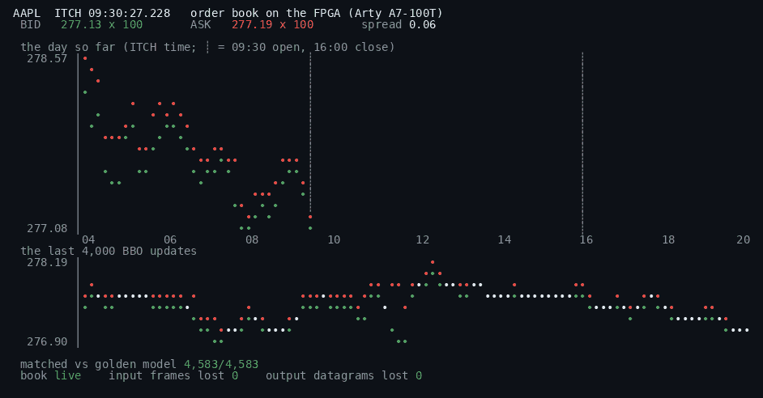](docs/media/2026-11-10_phase-d_board-full-day2-bbo.gif)

*Run `d2_shoot` ([sidecar](data/results/2026-11-10_full_day_board_16way.md)): the GIF and the
`compare` output are rendered from its log by `make demo-gif-day2` (the second image draws
the saved terminal output; it is not a screen grab). The plot (`make plots`) is the last BBO
per minute from run `d2_16way`: 850 minutes, 0¢ difference in every one
([CSV](data/results/2026-11-10_board_vs_model_bbo_1min_day2.csv)).*

## At a glance

| | |
|---|---|
| **Board / PHY** | Arty A7-100T (`xc7a100tcsg324-1`), TI DP83848J 10/100 MII |
| **Pipeline** | MII MAC → CDC → IPv4/UDP filter → MoldUDP64 → ITCH decoder → order table → price levels → BBO |
| **Pipeline latency T2−T1** | p50 / p99 / p99.9 / max: **136 / 192 / 232 / 232 ns** (17 / 24 / 29 / 29 cycles at 125 MHz), 831,842 BBOs on the board, AAPL 2019-10-18 ([CSV](data/results/2026-11-11_record_fifo_board.csv)) |
| **Pipeline capacity** | **14.4 M msg/s** at `DATA_W` 64, **4.11 M msg/s** at `DATA_W` 8 (on-chip injector on the board, the same 1,043 messages: 9,059 vs 31,703 cycles, each = simulation; [64](data/results/2026-11-15_injector_board_w64.csv), [8](data/results/2026-11-13_injector_board.csv)) |
| **Line-rate throughput** | Input at the full 100 Mbps: 35,310 of 35,313 frames, **374 k msg/s** offered (unpaced, AAPL day). With every BBO sent, the 100 Mbps *output* is the limit (64-byte records need 1.05-1.37× the input bytes): full day at **189 k msg/s** with 0 stall cycles and 0 drops; unpaced, the stall counters show the output stalling the feed and 2-3 frames overflow, counted and flagged stale ([line rate](data/results/2026-11-15_line_rate_board.md), [stall counters](data/results/2026-11-16_stall_counters_board.md)) |
| **Hardware full-day replay** | **0 mismatches on two days**: AAPL 2025-12-12, 916,429 / 916,429 BBO updates; AAPL 2019-10-18, 831,842 / 831,842; 0 frames lost, `table_overflow`/`unknown_ref` 0, never stale ([CSV](data/results/2026-11-10_full_day_board_16way.csv)) |
| **Whole-file replay, every symbol** | The entire 2019-10-18 NASDAQ file, **302,347,067 messages** unpaced at 94 Mb/s on the wire (13.9 min): **831,842 / 831,842 BBOs = model**, and the board's filter counters = model: 295,290,395 other-symbol messages skipped, 5,388,821 outside the ITCH subset, AAPL's locate learned from its one `R` message; 0 frames lost, 0 stalls ([sidecar](data/results/2026-11-19_whole_file_board.md)) |
| **Golden model, full day** | AAPL 2019-10-18: 1,669,591 messages, 0 unknown refs, 0 negative shares; peak 27,814 live orders ([CSV](data/results/2019-10-18_AAPL_summary.csv)) |
| **Order table** | 2-bank d-left, 2 × 2,048 × 16 = 65,536 entries, 100 BRAM36; **0 overflows** on both days, including a 54,981-live-order peak that overflowed a 4-way table of the same size 14,717 times ([CSV](data/results/2025-12-12_AAPL_bounded.csv)) |
| **Events verified in sim** | 1,009,900 random ITCH records plus both full days through the RTL book, 0 mismatches ([CSV](data/results/2026-11-10_sim_full_book.csv)) |
| **Functional coverage** | **178 / 178 bins (100 %), 0 exclusions**, merged over 28 regression parameter sets: ITCH type × side, MoldUDP64 paths, d-left bucket fill 0-15 and full, bitmap search by L2 group, both FCS modes, every message lane at `DATA_W` 64, MII and record FIFO occupancy (MII overflow included), backpressure on every `ob_core` interface (buildplan §8.2; `make cov`, [report](docs/reports/coverage/index.html)) |
| **Formal proofs** | Every buildplan §8.3 target, unbounded (k-induction), SymbiYosys: async FIFO (in fpga-eth-core); bitmap search returns the best level; MoldUDP64 sequence and gap logic matches the model's tracker for any byte stream; the order table never returns an order after its delete (any ref, any record sequence); AXI-Stream handshake at the deframer, order table, packet gate and 64-bit byte packer. 19 injected bugs, all caught (`make formal`, [`tb/formal/`](tb/formal/)) |
| **Bugs caught** | Listed [below](#bugs-found) and, with symptom → cause → fix, in the [lab notebook](docs/log.md) |
| **Fmax / timing** | **125.2 MHz** (1 / (8 ns − WNS), the release build: store-and-forward, `DATA_W` 8, rebuilt with `make impl` on 2026-11-20, 0 critical warnings). Full chip (with the injector) meets 125 MHz in every build: WNS +0.012 ns store-and-forward, +0.172 ns cut-through, +0.004 ns store-and-forward at `DATA_W` 64, Vivado 2025.2 ([sf](docs/reports/arty_top/summary.txt), [ct](docs/reports/arty_top_ct/summary.txt), [sf 64](docs/reports/arty_top_w64/summary.txt)) |
| **Utilization** | 12,818 LUT (20 %), 20,451 FF (16 %), 128 / 135 BRAM36 (95 %), 10 DSP ([report](docs/reports/arty_top/utilization.rpt)) |
| **CI** | `make ci` locally: Verilator lint, cocotb regression, formal, model tests, host build + tests (ASan/UBSan), clang-tidy, ruff; the same `make ci` runs on GitHub Actions on every push ([workflow](.github/workflows/ci.yml)) |

## Status

| Phase | State | Key result |
|---|---|---|
| A — Python golden model + data | **Complete** (`v0.1-model`) | Full-day replay; table and window sized from data |
| B — MAC + IPv4/UDP on hardware | Working on the board | [fpga-eth-core](https://github.com/RodeanAzari/fpga-eth-core) `eth-core-v0.1`/`v0.2` released and in use here; ILA capture checked on the board ([result](data/results/2026-11-21_ila_frame_board.md)) |
| C — MoldUDP64 + ITCH decoder | Working on the board | Trace mode, full AAPL day: **1,658,958 / 1,658,958** decoded messages = the golden parser, byte for byte ([sidecar](data/results/2026-11-22_trace_full_day_board.md)); waveform of one packet across 64-bit words ([sim](data/results/2026-11-22_feed_wave_w64.md)) |
| D — Order book engine | Working on the board | Two full days, 0 mismatches; table reshaped to 16 ways for the busier day ([ADR 0010](docs/decisions/0010-order-table-16-way.md)) |
| E — Timestamping + latency measurement | In progress | T0/T1/T2 in every BBO; T2−T1 on the board fully determined by message type ([sidecar](data/results/2026-11-11_record_fifo_board.md)); cut-through on the board: T2−T0 p50 126.7 → 64.2 µs ([sidecar](data/results/2026-11-13_ct_vs_sf_board.md)); injector 4.11 M msg/s at `DATA_W` 8, 14.4 M at 64 ([sidecar](data/results/2026-11-15_injector_board_w64.md)); T0 on hardware = simulation within 1 cycle ([sidecar](data/results/2026-11-15_t0_wire_board.md)); line rate 189 k msg/s with every BBO sent, output-bound ([sidecar](data/results/2026-11-16_stall_counters_board.md)). Left: scope cross-check |
| F — Stress, coverage closure, portfolio | In progress | Coverage 178 / 178 bins ([report](docs/reports/coverage/index.html)); every §8.3 formal target proved (`make formal`); whole 2019-10-18 file, every symbol, 0 mismatches on the board ([sidecar](data/results/2026-11-19_whole_file_board.md)). Left: the Phase E scope capture |

Design and decisions: [docs/design.md](docs/design.md). Lab notebook: [docs/log.md](docs/log.md).

## Architecture

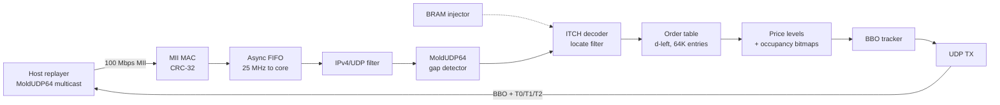

- **Clocking:** an MMCM makes the core clock (start 125 MHz) and the PHY's 25 MHz reference.
  The PHY's receive clock is the only other domain.
- **CDC:** one async FIFO (Gray pointers) and one toggle synchronizer for the T0 timestamp.
- **Interfaces:** AXI4-Stream between blocks, with backpressure everywhere except the MII
  input, which has an overflow counter.
- **Reuse:** the MAC and IPv4/UDP layer lives in its own payload-agnostic repo,
  [fpga-eth-core](https://github.com/RodeanAzari/fpga-eth-core), consumed here as a git
  submodule (`rtl/eth/`) at tag `eth-core-v0.4`. Two other FPGA projects use it too, so it
  knows nothing about ITCH.

## Verification, by layer

| Layer | State |
|---|---|
| Golden model | 225 pytest tests (model, analysis and host-tool checks, `make model-test`); full-day self-consistency on real data; per-message flag contract checked on 1,669,591 messages |
| cocotb vs. golden model | Every block and the whole chip (`ob_core`, frames in → datagrams out) scored against the model, 28 parameter sets (`DATA_W` 8/64, both FCS modes, small FIFOs) in `make sim`; injected bugs caught in each test (counts in the [lab notebook](docs/log.md)); functional coverage 178 / 178 bins ([report](docs/reports/coverage/index.html)) |
| Formal (SymbiYosys) | Async FIFO; bitmap search; MoldUDP64 sequence/gap logic (a shadow of the model's `SeqTracker` inside `mold_deframer_w8`); order table (one tracked ref against the spec, RAM by its proved read contract); AXI-Stream handshake at four block boundaries. Proofs that need internal state keep it in an `ifdef FORMAL` block next to the RTL. Not proved: the `DATA_W` 64 deframer (simulation only) |
| Hardware scoreboard | `analysis/compare.py` over a captured day: record by record, plus `unflagged_wrong` (a BBO wrong without its stale flag): 0 on every run, including 4 runs that lost input ([CSV](data/results/2026-11-09_board_loss_diagnosis.csv)); after an output loss, every received record still checked in place by its MoldUDP64 sequence number (`received_wrong`, [trace](data/results/2026-11-22_trace_full_day_board.md)); and the board's feed counters (MoldUDP64, ITCH filter, learned locate) against the model's, which shows the filter on messages that make no output ([whole file](data/results/2026-11-19_whole_file_board.md)); an ILA capture of one frame checked byte for byte against the sent packet and the model's records ([ILA](data/results/2026-11-21_ila_frame_board.md)) |

RTL testbenches use [tb-common](https://github.com/RodeanAzari/tb-common), a shared
cocotb library (AXI-Stream driver and monitor, an in-order scoreboard that dumps context
on the first mismatch, seeded random with logged seeds, and the functional-coverage merge
behind `make cov`). It's pinned at tag `tb-common-v0.2`. The Ethernet layer's own verification (formal FIFO proof, 21 cocotb
tests, planted bugs) is described in the
[fpga-eth-core README](https://github.com/RodeanAzari/fpga-eth-core#verification-by-layer).

The golden model comes in two forms:

- **Unbounded book:** defines the correct BBO.
- **Bounded book:** applies the RTL's exact limits (table geometry, price window and entry
  widths). It is what the hardware will be scored against.

The model tests each pin a failure mode that would silently corrupt the book, for example:

- using the execution price from `C` instead of the resting price;
- `U` forgetting the original order's side;
- dropping out-of-window orders so their cancels become unknown refs;
- one unknown message type desynchronizing everything after it.

A seeded adversarial generator produces table overflows, out-of-window prices, unknown refs,
crossed and locked books, and non-subset message types. A test fails if the generator ever
stops reaching any of them.

### Bugs found

1. **The specified order table could not work on real data.** Replaying the day's real
   order refs showed that the low ref bits cluster: one bucket held 18 live orders at
   16,384 sets. Even a good hash leaves Poisson peaks of 8, so a single-hash 4-way table
   overflows at any size that fits. Caught by the golden model before any RTL was written.
   The fix is [ADR 0001](docs/decisions/0001-order-table.md).
2. **The generator never produced a locked book.** Crossing orders were never removed, so
   the book stayed permanently crossed. Caught by the generator's coverage test.
3. **The generator never triggered the out-of-window flag.** Far prices always sat on the
   harmless side of the window. Caught by the same test.
4. **The 4-way table overflowed on a busier day.** AAPL 2025-12-12 peaks at 54,981 live
   orders; the bounded model overflowed the 4-way table 14,717 times and went stale from
   pre-market. Caught by the golden model on the second day; fixed by 16 ways in the same
   BRAM ([ADR 0010](docs/decisions/0010-order-table-16-way.md)).
5. **A formally proven async FIFO still had unsafe crossings.** Vivado's clock-interaction
   report flagged them: the TX FIFO had mapped to distributed RAM, whose asynchronous read
   is itself a crossing, and synthesis merged a Gray pointer bit into the binary one, so
   the max-delay constraint missed it. Caught by the Vivado CDC report; fixed by forcing
   block RAM and `DONT_TOUCH` on the Gray registers (fpga-eth-core).
6. **A good cut-through frame came out marked bad.** The oversize-hold flag was set on the
   cycle its last beat left and leaked into the next frame. Caught by cocotb (`eth_rx`
   cut-through test, fpga-eth-core).
7. **In cut-through, the stale flag landed on the wrong BBO.** `ob_core` sampled the live
   feed-stale signal when a record entered the book, but a frame's FCS verdict arrives one
   cycle after the frame, so a bad packet's own last BBO disagreed with the model. Caught
   by cocotb (`test_core ct_bad_frames`, one seed); fixed by carrying stale in-band with
   each message ([ADR 0016](docs/decisions/0016-in-band-stale.md)).
8. **A 13,348-cycle latency tail on the board.** The first board latency run showed T2−T1
   peaks to 13,348 cycles: the output packet writer back-pressured the book. Caught by the
   hardware latency analysis (`analysis/latency_causes.py`); a 545-record FIFO removed it,
   and now every BBO takes exactly its no-wait cycle count
   ([ADR 0012](docs/decisions/0012-record-fifo.md)).
9. **Cut-through failed timing by −0.567 ns.** A 23-level path ran from the record FIFO's
   full flag through backpressure into the deframer's sequence adder. Caught by Vivado;
   fixed in three steps: `seq + count` registered a cycle early, the FIFO's `full` from a
   register, and `t0_track` keeping its pending occupancy in registers (WNS +0.172 ns).
10. **A test passed with the stale flag removed.** In the first MII-overflow test every
    Add set a new best price, so a lost Add changed nothing visible. Caught by bug
    injection (removing the stale flag did not fail it); the stimulus now makes losses
    visible and asserts that some BBOs differ.
11. **Host-side loss looked like FPGA loss.** Board runs lost output datagrams that the
    board never counted. The host's USB adapter (`cdc_ncm` over usbip) dropped them, with
    `ip -s link` TX drops equal to the missing count; an earlier NIC reordered ~0.05 % of
    datagrams. Caught by `compare.py`'s sequence check and the board's own counters;
    accounted in each sidecar rather than fixed (host path).

Bugs planted to prove the checks work: each cocotb test was run against injected RTL bugs
(which ones, and the count per test, are in the [lab notebook](docs/log.md)), and 19
against the formal proofs, all caught.

## The order table

**What it does:** `E`, `C`, `X`, `D` and `U` messages carry only an order reference, with no
price or side. The book needs a ref → order table in BRAM, and capacity is the hard limit.

**Measured (AAPL, 2019-10-18):** 27,814 peak live orders, max ref 287,271,257 (29 bits),
largest order 82,045 shares.

| Design (banks × sets × ways) | Entries | Worst bucket over the day | Overflow inserts | BRAM36 |
|---|---|---|---|---|
| 1 × 16,384 × 4, low-bits hash | 65,536 | 18 | not run | 96 |
| 1 × 16,384 × 4, multiplicative hash | 65,536 | 8 | 36,545 | 96 |
| 2 × 4,096 × 4, d-left | 32,768 | n/a | 55,626 | 48 |
| 2 × 8,192 × 4, d-left (first choice, ADR 0001) | 65,536 | ≤ 4 | 0 | 96 |
| **2 × 2,048 × 16, d-left (chosen, ADR 0010)** | **65,536** | **≤ 16** | **0, and 0 on day 2** | **100** |

Sources: [`_table_fill.csv`](data/results/2019-10-18_AAPL_table_fill.csv),
[`_table_dleft.csv`](data/results/2019-10-18_AAPL_table_dleft.csv).

**A second, busier day changed the shape.** AAPL on 2025-12-12 peaks at 54,981 live orders,
84 % of the table. The 4-way table overflowed 14,717 times there, and the book was flagged
stale from pre-market on. The same 65,536 entries arranged as 16 ways (2 × 2,048 × 16) have
0 overflows on both days: a wider bucket tolerates a fuller table. It costs 4 BRAM36 and
about 4,800 LUTs, and timing still closes ([ADR 0010](docs/decisions/0010-order-table-16-way.md),
[`2025-12-12_AAPL.md`](data/results/2025-12-12_AAPL.md)).

**Chosen:** two banks, each indexed by a multiplicative hash with its own odd multiplier,
both read in the same cycle. An insert goes to the emptier bucket. Because an odd multiplier
is a bijection, the remaining product bits are a complete tag (21 bits at 2,048 sets), so an
entry is 56 bits. Width limits (`ref_overflow`, `shares_overflow`) are counted, never
truncated.

**Verified:** in this exact configuration, the bounded golden model had zero table, ref,
shares and unknown-ref errors on both days
([day 1](data/results/2019-10-18_AAPL_bounded_2x2048x16.csv),
[day 2](data/results/2025-12-12_AAPL_bounded_2x2048x16.csv)), and so did the RTL, in
simulation ([`sim_full`](data/results/2026-11-10_sim_full_book.csv)) and on the board
([board](data/results/2026-11-10_full_day_board_16way.csv)).

## Price levels and the price window

Per side, a BRAM array of aggregate shares covers 4,096 one-cent ticks around a base fixed
for the day, with a two-level occupancy bitmap to find the next best level when the top
empties. Both options are documented in §6.4 of the spec: a sorted top-K register array was
rejected because it loses depth.

- **Base:** the golden model's opening mid, $234.55 ([ADR 0002](docs/decisions/0002-price-window-base.md)).
- **Coverage:** the window held 831,837 of 831,839 two-sided BBOs.
- **The two misses:** both were in a nearly empty book at the session edges (04:00:11, bid
  $175.12; 20:00:00, ask $260.00).
- **Out-of-window orders:** 16,099 orders (1.85 %) priced outside the window, mostly stub
  quotes. They stay in the order table so their cancels resolve.

**How the hardware knows its BBO is wrong:** it never stores an out-of-window order's price,
only which edge the order fell past. Four live counters (per side, better or worse than the
window) set an `out_of_window` flag on the BBO. The flag fires exactly when the published
BBO differs from the true one: 0 violations over every message of the day, and 4 flagged
updates in total.

## Timestamping and cut-through

Every BBO record carries three stamps from one 125 MHz counter ([ADR 0011](docs/decisions/0011-timestamps.md),
[docs/latency.md](docs/latency.md)): **T0**, the cause frame's SFD (±40 ns); **T1**, the
cause message's last byte at the decoder; **T2**, the BBO valid at the book's output.
T2−T1 is the pipeline latency. T2−T0 also contains the frame's serialization at 80 ns/byte
and the store-and-forward wait for its FCS, so it is the line-rate bound, not the pipeline.

| Metric (board, AAPL 2019-10-18, 831,842 BBOs, 500 pps) | min | p50 | p99 | p99.9 | max |
|---|---|---|---|---|---|
| T2−T1, ns | 112 | 136 | 192 | 232 | 232 |
| T2−T0, µs | 74.2 | 126.7 | 133.1 | 133.7 | 133.8 |

**No BBO waited.** Each one took exactly the no-wait cycle count of its cause: 17 cycles
for an Add, Delete or Reduce that keeps the best level, 23 when it empties the best, 24 for
a Replace, 29 for a Replace whose old order was alone at the best
([per cause](data/results/2026-11-11_record_fifo_board_causes.csv)). The first run had a
tail to 13,348 cycles: the output writer paced the book. A 545-record FIFO in front of the
writer removed it ([ADR 0012](docs/decisions/0012-record-fifo.md)).

**Cut-through** ([ADR 0013](docs/decisions/0013-cut-through.md)) is a build option. The
decoder sees each byte as it arrives instead of after the frame's FCS. The cost: a frame
that later fails its FCS has already moved the book, so it is counted (`cut_through_bad`)
and marks the book stale. In simulation, a 1,514-byte frame's first byte reaches the
decoder 520 ns after its SFD, against 121.5 µs store-and-forward. On the board, the same
day in both builds gives the same 831,842 BBOs (each identical to the model) and the same
T2−T1; T2−T0 drops by 7.2 to 115.1 µs per BBO, never rising
([sidecar](data/results/2026-11-13_ct_vs_sf_board.md)):

[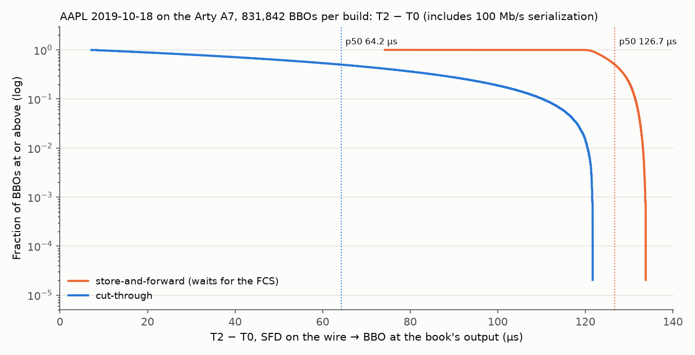](docs/media/2026-11-13_phase-e_board-t2-t0-ct-vs-sf.png)

| T2−T0 on the board, µs | min | p50 | p99 | p99.9 | max |
|---|---|---|---|---|---|
| store-and-forward | 74.2 | 126.7 | 133.1 | 133.7 | 133.8 |
| cut-through | 7.2 | 64.2 | 120.5 | 121.6 | 121.7 |

## Pipeline capacity

An on-chip injector ([ADR 0014](docs/decisions/0014-injector.md)) replays a ROM of 22
MoldUDP64 packets (1,043 AAPL messages, 31,679 payload bytes) straight into the feed path
at full clock rate, with no Ethernet in the way. The board counts the cycles from the first
byte to the last BBO and folds every BBO into a digest, which the host compares with the
model's. The feed path is parameterized by width ([ADR 0015](docs/decisions/0015-64-bit-feed-path.md)):
at `DATA_W` 8 it takes one byte per cycle; at 64, eight.

[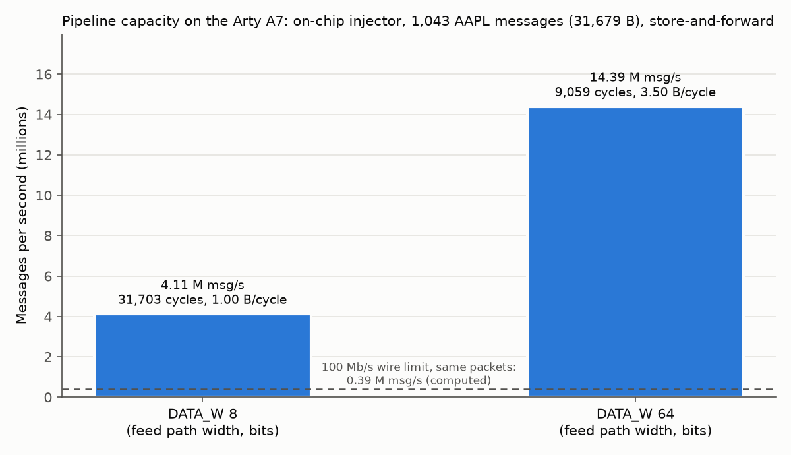](docs/media/2026-11-15_phase-e_board-capacity-w8-vs-w64.png)

| Board, store-and-forward, 125 MHz | cycles | M msg/s | bytes/cycle | BBOs, digest |
|---|---|---|---|---|
| `DATA_W` 8 | 31,703 | 4.11 | 1.00 | 248, = model |
| `DATA_W` 64 | 9,059 | 14.4 | 3.50 | 248, = model |

Each figure is the same on every board run and equal to simulation to the cycle
([8](data/results/2026-11-13_injector_board.md), [64](data/results/2026-11-15_injector_board_w64.md)).
At 8 the input sets the rate. At 64 it no longer does (3.5 of 8 bytes per cycle used); which
later stage does is not measured yet. The full AAPL day also matches the model at 64
(831,842 / 831,842), with T2−T1 unchanged: the wider path sits before T1
([sidecar](data/results/2026-11-15_w64_full_day_board.md)). These are short bursts of
one pre-market mix (mostly Add and Delete), not a sustained rate over a whole day.

## On the board, demos, in Vivado

The host (WSL2) sends the day as MoldUDP64 multicast with `host/replay` (C++, busy-wait
pacing) and configures the board and logs its output with `host/capture`;
`scripts/board_run.sh` runs both and then `analysis/compare.py`.

- **Full day, zero mismatches** at 500 and 200 packets/s ([CSV](data/results/2026-11-09_full_day_board.csv)).
- **What the board does under host bursts** ([diagnosis](data/results/2026-11-09_board_loss_diagnosis.md)):
  on a loaded host the replayer stalls and then sends late packets back to back. In a burst
  the board's output (64-byte BBO records) needs more wire time than its input, so
  backpressure fills the 2 KB MII FIFO and frames are dropped. Every drop is counted and
  every later BBO is flagged stale: never a silently wrong book. On a quiet host there are
  no drops. Since 2026-11-16 two stall counters (stats 45, 46) measure this on the board.
- **Host output loss:** in the line-rate runs the host lost a few to thousands of output
  datagrams with no Linux counter moving (the USB adapter, usbip or the FPGA TX; not yet
  told apart), so those runs show only that every received BBO is right.
- **Live demo:** `analysis/bbo_view.py` (the GIF above).
- **Vivado:** batch Tcl only (`syn/`), reports per build in [`docs/reports/`](docs/reports/).

### ILA: one frame from the MII pins to the decoder

`make impl ILA=1` adds two ILA cores to the release build (WNS +0.032 ns), one per
clock domain. `scripts/ila_run.sh` programs it, replays the feed at 2 packets/s and
captures one frame. `analysis/ila_frame.py` then checks the capture against the bytes
the host sent: the MII frame's FCS is good, eth_rx's output is that frame byte for byte,
udp_rx's payload is the sent packet, and the decoder's 47 record types are the golden
model's ([result](data/results/2026-11-21_ila_frame_board.md)).

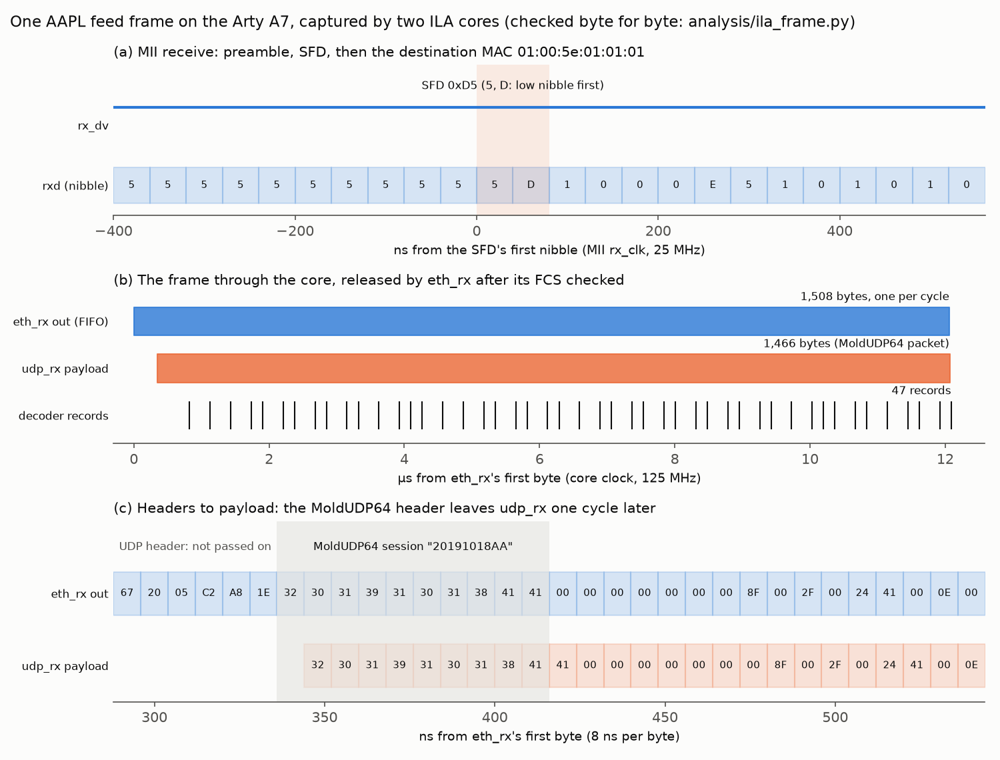

| Clock | Sample | Signal | Value | What it is |
|---|---|---|---|---|
| rx_clk 25 MHz | 32-45 | rxd | 5 5 … 5 (14 nibbles) | preamble, one nibble per 40 ns |
| | 46-47 | rxd | 5, D | SFD 0xD5, low nibble first |
| | 48-59 | rxd | 1 0, 0 0, E 5, 1 0, 1 0, 1 0 | destination MAC 01:00:5e:01:01:01 (IPv4 multicast) |
| core 125 MHz | 213-218 | eth_rx out | 01 00 5E 01 01 01 | the same MAC, one byte per 8 ns, after the whole frame's FCS was checked |
| | 225-226 | eth_rx out | 08 00 | EtherType IPv4 |
| | 243-246, 249-250 | eth_rx out | EF 01 01 01, 67 20 | feed group 239.1.1.1, UDP port 26400 |
| | 256-265 | udp_rx payload | 32 30 31 39 31 30 31 38 41 41 | MoldUDP64 session `20191018AA`, one cycle behind eth_rx |
| | 266-273, 274-275 | udp_rx payload | … 8F, 00 2F | sequence 143, 47 messages |
| | 276-278 | udp_rx payload | 00 24, 41 | first message: 36 bytes, type `A` (Add Order) |
| | 316 | decoder record | `A` | its record, 3 cycles after its last byte (sample 313) |

The two cores have separate clocks and triggers, so sample numbers compare only within
one core. The full table is printed by `analysis.ila_frame --table`.

### The same packet across 64-bit words (simulation)

At `DATA_W` 64 a message can start in any of the 8 byte lanes. The deframer drops the
length prefixes, and the aligner moves each message to lane 0 so the decoder reads every
field at a fixed offset. `make wave-feed` runs this packet through `feed_frontend` at
`DATA_W` 64 and checks every record against the golden model. Its 47 record types are the
ones the ILA saw on the board ([sidecar](data/results/2026-11-22_feed_wave_w64.md)).

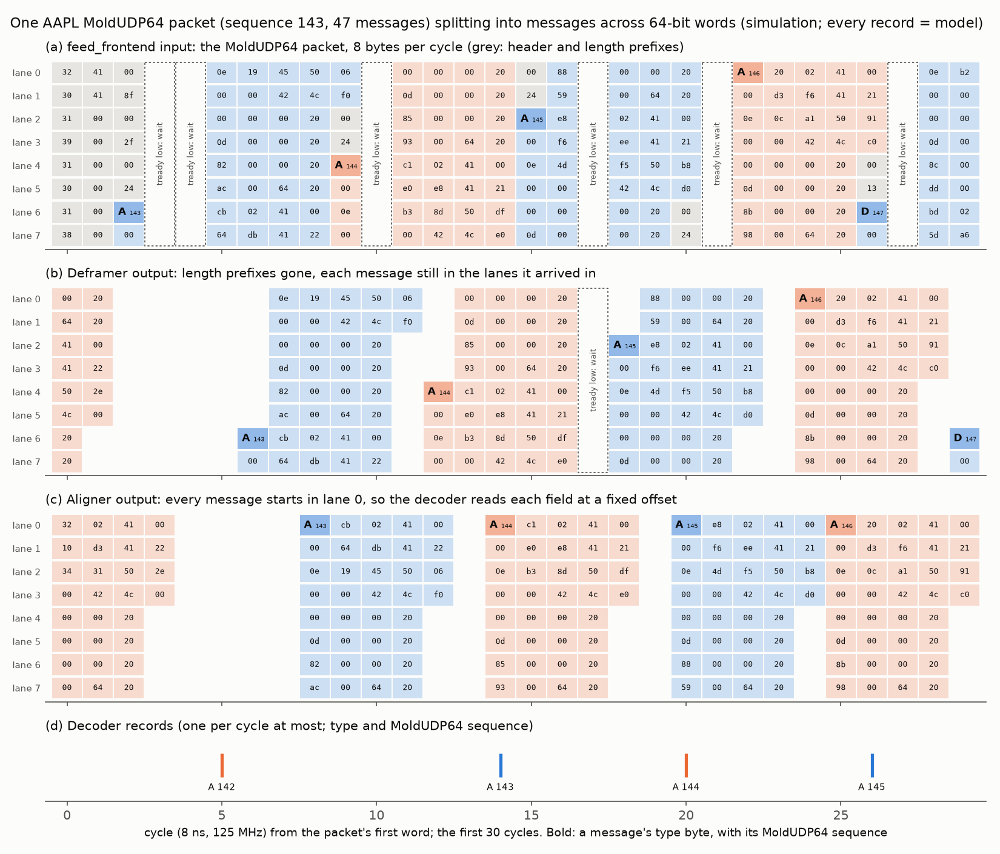

### In Vivado

The release build (store-and-forward, `DATA_W` 8, `make impl` on 2026-11-20), routed
checkpoint opened with `make gui-views`. Numbers in
[`docs/reports/arty_top/`](docs/reports/arty_top/).

| | |
|---|---|
| 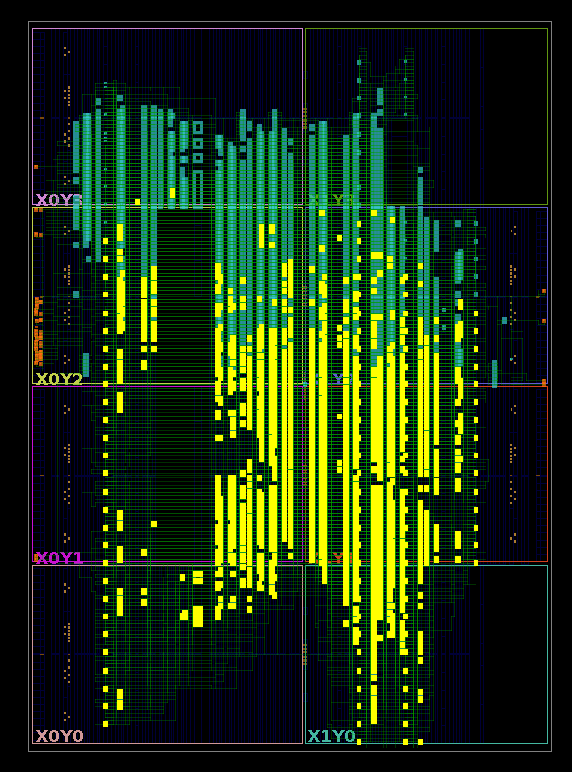 | 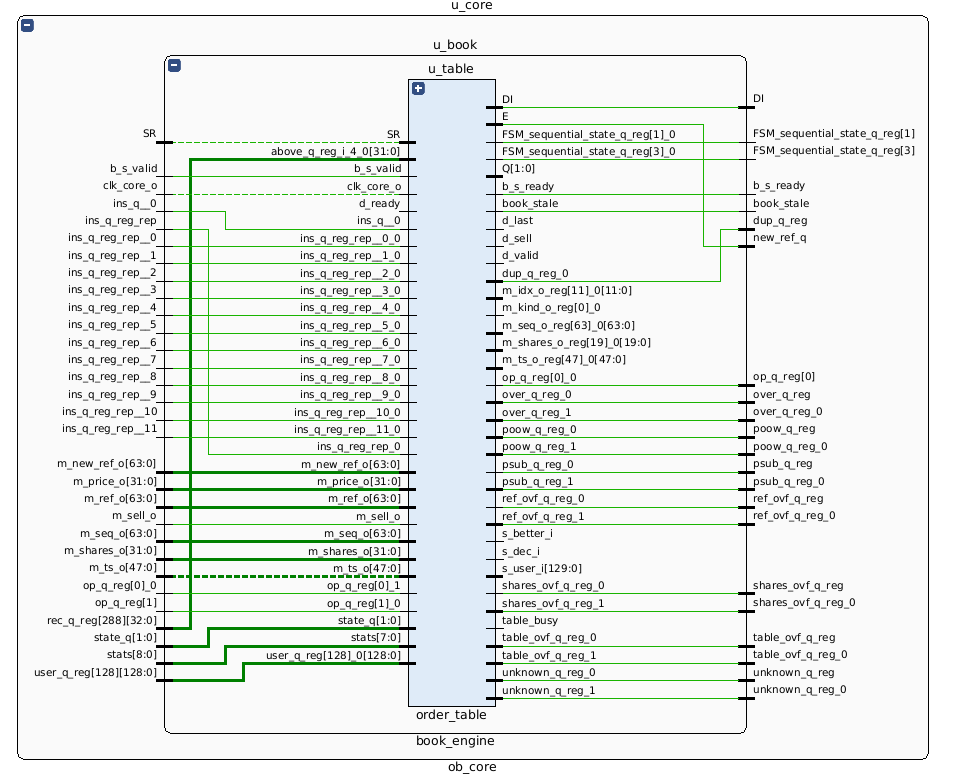 |
| **Device view.** The order table's cells in yellow: 100 of the 128 BRAM tiles used (2 banks × 50). | **Order table** (`u_core/u_book/u_table`, ADR 0001/0010) in its place in the hierarchy. |
| 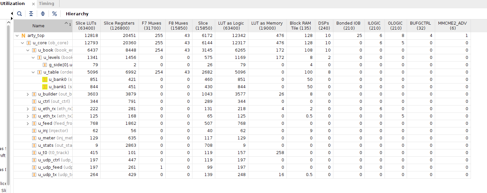 | 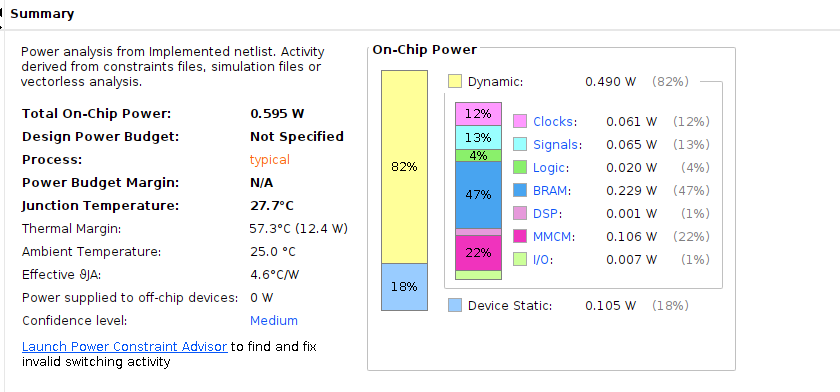 |
| **Utilization by hierarchy:** 12,818 LUT, 20,451 FF, 128 / 135 BRAM tiles, 10 DSP ([report](docs/reports/arty_top/utilization_hier.rpt)). | **Power:** 0.595 W on chip, 0.490 W dynamic, BRAM the largest share. Vectorless estimate, confidence "Medium", not measured on the board ([report](docs/reports/arty_top/power.rpt)). |
| 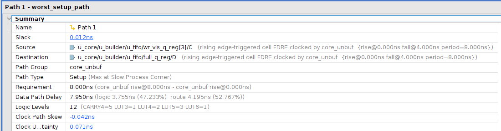 | 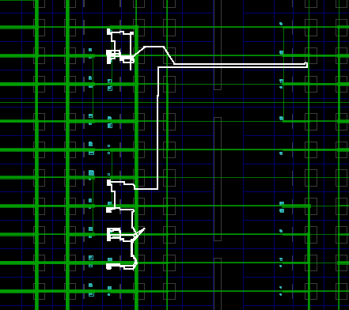 |
| **Worst setup path:** slack +0.012 ns at 8 ns, 12 logic levels, in the output builder's FIFO full flag (`u_builder/u_fifo`): 47 % logic, 53 % route ([timing](docs/reports/arty_top/timing_summary.rpt)). | **The same path routed** on the die. |

## Results

| Result | Value | Conditions | Source |
|---|---|---|---|
| Messages in the day | 302,347,067 | `S101819-v50.txt.gz`, all symbols | [by_type](data/results/2019-10-18_AAPL_by_type.csv) |
| AAPL messages | 1,669,591 | locate 14 | [summary](data/results/2019-10-18_AAPL_summary.csv) |
| Peak concurrent live orders | 27,814 | AAPL, unbounded model | [summary](data/results/2019-10-18_AAPL_summary.csv) |
| Two-sided BBOs inside window | 831,837 / 831,839 | base 23,455 ticks, ±2,048 | [summary](data/results/2019-10-18_AAPL_summary.csv) |
| Table overflow, chosen table | 0 / 0 | 2 × 2,048 × 16 d-left, day 1 / day 2 | [day 1](data/results/2019-10-18_AAPL_bounded_2x2048x16.csv), [day 2](data/results/2025-12-12_AAPL_bounded_2x2048x16.csv) |
| `bbo_oow` (flagged updates) | 4 | same | [bounded](data/results/2019-10-18_AAPL_bounded.csv) |
| Golden-model full-day run time | 4 min 08 s | Python 3.14, WSL2 | [sidecar](data/results/2019-10-18_AAPL.md) |
| **Hardware full day: BBO updates identical to the model** | **831,842 / 831,842** | AAPL 2019-10-18, 500 and 200 pps, 4 runs | [full day](data/results/2026-11-09_full_day_board.csv) |
| Hardware: frames lost / feed gaps / stale | 0 / 0 / never | quiet host | [full day](data/results/2026-11-09_full_day_board.csv) |
| Hardware: `bbo_oow` / `price_oow` | 4 / 16,099 (= model) | ADR 0002 window | [full day](data/results/2026-11-09_full_day_board.md) |
| **Hardware, whole file (all symbols): BBO updates and filter counters = model** | **831,842 / 831,842**; other-locate 295,290,395, unknown type 5,388,821, directory match 1 | 2019-10-18, 302,347,067 messages unpaced, 361,876 msg/s | [whole file](data/results/2026-11-19_whole_file_board.md) |
| **Hardware full day, trace mode: decoded messages identical to the model** | **1,658,958 / 1,658,958** | AAPL 2019-10-18, 200 pps; two earlier runs at 500 pps lost data, all counted | [trace](data/results/2026-11-22_trace_full_day_board.md) |
| RTL sim, random records vs model | 1,009,900, 0 mismatches | seeded generator | [sim](data/results/2026-11-07_sim_random_1m.csv) |
| **Hardware day 2: BBO updates identical to the model** | **916,429 / 916,429** | AAPL 2025-12-12 (3.5 M AAPL messages), 500 pps, 2 runs | [16-way runs](data/results/2026-11-10_full_day_board_16way.md) |
| Hardware runs at host load 15 to 22 | 2 of 4 clean; failures were host receive loss and an MII FIFO overflow, both detected (0 unflagged wrong BBOs) | 16-way bitstream | [16-way runs](data/results/2026-11-10_full_day_board_16way.md) |
| Full-chip timing (with the injector) | 125 MHz met, WNS +0.012 ns store-and-forward, +0.172 ns cut-through | Vivado 2025.2 | [sf](docs/reports/arty_top/summary.txt), [ct](docs/reports/arty_top_ct/summary.txt) |
| **Pipeline latency T2−T1 (board)** | **p50 136 ns, p99 192 ns, max 232 ns** | AAPL 2019-10-18, 831,842 BBOs, 500 pps | [sidecar](data/results/2026-11-11_record_fifo_board.md) |
| T2−T0, line-rate bound (board) | p50 126.7 µs, max 133.8 µs | same; store-and-forward | [sidecar](data/results/2026-11-11_record_fifo_board.md) |
| T2−T0, line-rate bound (board), cut-through | p50 64.2 µs, max 121.7 µs; 831,842 / 831,842 BBOs = model | same day; `CUT_THROUGH=1` | [sidecar](data/results/2026-11-13_ct_vs_sf_board.md) |
| Pipeline capacity (on-chip injector, board) | 4.11 M msg/s: 1,043 msgs in 31,703 cycles, 248 BBOs, digest = model, = simulation | `DATA_W` 8 (input-bound), both builds | [sidecar](data/results/2026-11-13_injector_board.md) |
| **Pipeline capacity (on-chip injector, board)** | **14.4 M msg/s**: same 1,043 msgs in 9,059 cycles (3.50× `DATA_W` 8), 248 BBOs, digest = model, = simulation | `DATA_W` 64, store-and-forward, 3 runs | [sidecar](data/results/2026-11-15_injector_board_w64.md) |
| Hardware full day at `DATA_W` 64 | 831,842 / 831,842 BBOs = model; T2−T1 p50 / max 136 / 232 ns (unchanged); T2−T0 +16 to +96 ns vs `DATA_W` 8 | AAPL 2019-10-18, 500 pps, 1 run | [sidecar](data/results/2026-11-15_w64_full_day_board.md) |
| Full-chip timing at `DATA_W` 64 | 125 MHz met, WNS +0.004 ns, 127 / 135 BRAM tiles | Vivado 2025.2, store-and-forward | [summary](docs/reports/arty_top_w64/summary.txt) |
| Line rate, input (board) | 35,310 / 35,313 frames, 374 k msg/s offered; 3 MII FIFO overflows, counted, book flagged stale, 0 unflagged wrong BBOs | unpaced full day, `DATA_W` 64 | [sidecar](data/results/2026-11-15_line_rate_board.md) |
| **Line rate with every BBO sent (board)** | **189 k msg/s** (4,000 pps): 0 overflows, never stale (`DATA_W` 64 and 8), 0 stall cycles (`DATA_W` 8); at 5,000 and 6,000 pps 1 and 2 frames overflowed, flagged | full day, 2 runs at 4,000 pps | [line rate](data/results/2026-11-15_line_rate_board.md), [stalls](data/results/2026-11-16_stall_counters_board.md) |
| Output stall at line rate (board) | `out_stall_cycles` 248,625, `rx_stall_cycles` 239,413 (unpaced, 309 k msg/s): the 100 Mbps TX stalls the book, the book stalls the feed | `DATA_W` 8 | [sidecar](data/results/2026-11-16_stall_counters_board.md) |

## Limitations

- **100 Mbps.** The Arty has no transceivers and cannot do 10GbE. Validated on Arty A7 at
  100 Mbps. The datapath is parameterized by width; the on-chip injector sustains 14.4 M
  msg/s through the pipeline (`DATA_W` 64, over a 1,043-message burst), so the 100 Mbps PHY,
  not the pipeline, is the throughput limit. With every BBO sent, the output side of that
  link binds first: 64-byte records need more bytes than the input carried, so a full day
  runs clean at 189 k msg/s, not at the 374 k msg/s the input link delivers. Pipeline latency (last message byte → BBO):
  p50 136 ns / p99 192 ns / max 232 ns.
- **One symbol; sizing from two days.** The order table is sized from AAPL on 2019-10-18
  and 2025-12-12; the busier day fills it to 84 % at its peak. Overflow is counted, not
  silent, if a busier day outgrows it.
- **Fixed-rate or line-rate replay, not real-time.** The AAPL days were sent at a fixed
  500 or 200 packets/s and the whole file unpaced at line rate; real-time pacing (with the
  market's own bursts) is not claimed.
- **Host output loss is not explained.** In the line-rate AAPL runs the host lost output
  datagrams outside every Linux counter; those runs show only that each received BBO is
  right. The whole-file run (about 1,000 BBOs/s out) lost none.
- **Not everything is formally proven.** The `DATA_W` 64 deframer is verified in
  simulation only; the order-table proof uses a 4 × 2 table with small hash multipliers
  (the logic needs only a bijective hash, which any odd multiplier gives).
- **One board day per configuration.** Cut-through and `DATA_W` 64 each have one full-day
  board run; the whole-file replay is one run of store-and-forward `DATA_W` 8.
- **The host must be quiet.** A loaded WSL2 host stalls the replayer for up to 100+ ms,
  which overflows the board's 2 KB input FIFO (counted and flagged, see above).
- **No retransmission.** A MoldUDP64 gap marks the book stale; it is never repaired.
- **Fixed price window.** No recentering during the day; out-of-window BBOs are flagged.
- **No published checksum for the day file.** Integrity rests on `gzip -t` and our own
  SHA-256 ([MANIFEST](data/MANIFEST.md)).

## Build and reproduce

Linux or WSL2 with Python ≥ 3.11 and GNU make; Verilator, cocotb, SymbiYosys (oss-cad-suite)
and Vivado 2025.2, with every version pinned in [docs/toolchain.md](docs/toolchain.md). The
day file (3.95 GB, not committed) goes in `/mnt/d/itch/` or `ITCH_DAY=...`; see
[data/MANIFEST.md](data/MANIFEST.md).

| Target | Does |
|---|---|
| `make setup` | Create `.venv` from pinned `requirements.txt` |
| `make model-test` | ruff, `mypy --strict` and pytest on the golden model |
| `make day-stats` | Full-day replay of AAPL through the golden model (about 4 minutes) |
| `make plots` | Regenerate every plot in `docs/media/` from `data/results/` |
| `make lint sim formal` | Verilator lint, cocotb regression, SymbiYosys proofs |
| `make cov` | Regression with functional coverage; merged report in `docs/reports/coverage/` |
| `make sim-full` | The RTL book on 1M+ random records and the whole AAPL day (minutes) |
| `make impl` (= `synth`, `reports`) | Full chip in Vivado batch: bitstream in `build/`, timing/utilization/CDC reports in `docs/reports/<build>/`; `TOP_ARGS="8 ct 8"` etc. picks the build; `ILA=1` adds two ILA cores (`build/<build>_ila/`, reports kept out of `docs/`) |
| `make host host-test` | C++ host tools (Release + Debug/ASan/UBSan) and their tests |
| `make ci` | Everything CI runs, locally |
| `make prog` | Program the Arty over JTAG (bitstream from `make impl`) |
| `scripts/board_run.sh` | One hardware run: configure, replay, capture, compare |
| `make demo-gif` | Render the demo GIF from a recorded run |
| `make demo-gif-day2` | Render the day-2 GIF and `compare` image from run `d2_shoot` |
| `make clean` | Remove caches and build output |

The sizing and bounded-model runs are listed with their exact commands in
[the results sidecar](data/results/2019-10-18_AAPL.md). Board runs need the host set up as in
[docs/log.md](docs/log.md) (2026-11-09). `make ci` (lint, sim, formal, model-test, host,
host-test, clang-tidy, ruff) also runs on GitHub Actions on every push; Vivado, `make cov`,
`make sim-full` and the board runs are local only.

## Repository layout

| Path | Contents |
|---|---|
| `model/` | Golden model: ITCH parser, unbounded and bounded books, seeded generator, tests |
| `analysis/` | Day stats, symbol extract, table sizing, bounded-model check, plots |
| `data/results/` | The CSVs behind every number, each with a sidecar `.md` |
| `docs/` | Design, ADRs, lab notebook, media |
| `rtl/` | SystemVerilog: `eth/` (fpga-eth-core submodule), `feed/`, `book/`, `out/`, `top/`, `lib/` |
| `tb/` | cocotb tests and SymbiYosys proofs |
| `host/` | C++ replayer and capture tool |
| `syn/`, `constr/`, `scripts/` | Vivado Tcl, XDC, board-run scripts |

## Related repositories

This project owns two shared repos, built here and consumed only at release tags:

| Repo | What it is | Used here as |
|---|---|---|
| [fpga-eth-core](https://github.com/RodeanAzari/fpga-eth-core) | Payload-agnostic 10/100 Ethernet MAC + IPv4/UDP RX/TX for 7-series FPGAs, with two non-ITCH example designs and C++ host test tools | Git submodule at `rtl/eth/`, tag `eth-core-v0.4` |
| [tb-common](https://github.com/RodeanAzari/tb-common) | Shared cocotb helpers: AXI-Stream driver/monitor, in-order scoreboard, seeded RNG, coverage merge/report | `pip` dependency pinned at `tb-common-v0.2` in `requirements.txt` |

## Roadmap

- **Phase E:** an oscilloscope cross-check of T2−T1 from the Pmod pulses (JA1/JA2).
- **Open questions:** the host output loss at line rate; a sustained (not burst) capacity
  figure at `DATA_W` 64 and which stage then limits it.
- **Release:** `v0.5-latency` after the scope capture, then `v1.0`.

## License

MIT, see [LICENSE](LICENSE). The `rtl/eth/` submodule (`fpga-eth-core`) is a separate
repository with its own terms.
